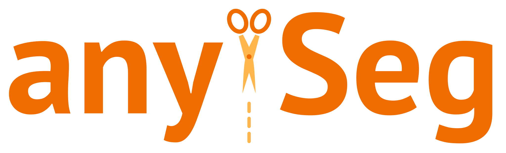

# anySeg



**anySeg** segments text into tokens, words and sentences with their positions in the source text: a Rust core and a Python package without dependencies. The text is never changed - every token and sentence is a span of the original string - and the tokens follow the conventions of [Universal Dependencies](https://universaldependencies.org/), so the results can be compared with the treebanks and with the tools trained on them. One package serves all languages: the rules are shared, and a language brings its lists. Russian comes first, Spanish and English follow.

!!! note "Early version"
    Before 1.0 the API may change between 0.x versions.

## Features

<div class="grid cards" markdown>

-   :material-content-cut:{ .lg .middle } __Segmenter__

    ---

    Tokens and sentences with their positions, a document of a text, lists of your own abbreviations and tokens

    [:octicons-arrow-right-24: Segmenter](segmenter.md)

-   :material-file-tree-outline:{ .lg .middle } __Document__

    ---

    Tokens, words with the columns of CoNLL-U, sentences, paragraphs and lines; reading and writing CoNLL-U

    [:octicons-arrow-right-24: Document](document.md)

-   :material-alphabet-cyrillic:{ .lg .middle } __Russian__

    ---

    How Russian text is split: abbreviations, hyphenated words, numbers, the web, dialogue, lists and verse

    [:octicons-arrow-right-24: Russian](russian.md)

-   :material-speedometer:{ .lg .middle } __Comparison__

    ---

    Quality and speed against razdel, NLTK, spaCy, Stanza, trankit, SaT and other tools

    [:octicons-arrow-right-24: Comparison](comparison.md)

</div>

## Installation

Python 3.11 or newer is required.

``` bash
pip install anyseg
```

Prebuilt wheels need no Rust; building from source and the Rust crate: see [Installation](installation.md).

## Quick start

=== "Code"

    ``` python
    from anyseg import Segmenter

    segmenter = Segmenter("ru")
    [span.text for span in segmenter.sentenize("Кот спал в 1914 г. Затем ушёл, т. е. исчез.")]
    segmenter.tokenize("Ёж идёт домой")
    ```

=== "Result"

    ```
    ['Кот спал в 1914 г.', 'Затем ушёл, т. е. исчез.']
    [Span(start=0, end=2, text='Ёж'), Span(start=3, end=7, text='идёт'), Span(start=8, end=13, text='домой')]
    ```

Positions are offsets in the characters of a Python string: `text[span.start:span.end] == span.text`. A document holds the tokens, the words with the columns of [CoNLL-U](https://universaldependencies.org/format.html), the sentences, the paragraphs and their lines:

=== "Code"

    ``` python
    doc = segmenter.segment("Ёж идёт домой\n\nКот спит")
    doc.set_columns(upos=["NOUN", "VERB", "ADV", "NOUN", "VERB"])
    [sentence.text for sentence in doc.sentences], doc.words[1]
    ```

=== "Result"

    ```
    (['Ёж идёт домой', 'Кот спит'], Word(id=2, form='идёт', upos='VERB'))
    ```

??? note "Project structure"

    *   **crates/anyseg** - the core in Rust: tokens, sentences, the document model and CoNLL-U, with the lists of every language in `data/` behind a Cargo feature
    *   **crates/anyseg-py** - the Python module `anyseg._anyseg` built with PyO3
    *   **python/anyseg** - the Python package
    *   **scripts** - checking the installed package before publishing
    *   **docs** - MkDocs documentation
    *   **tests** - tests of the Python package
